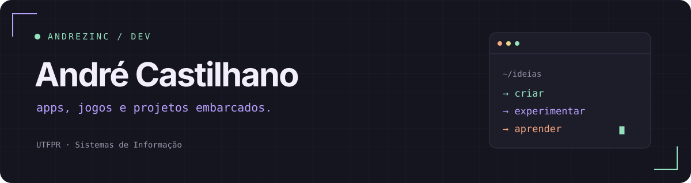
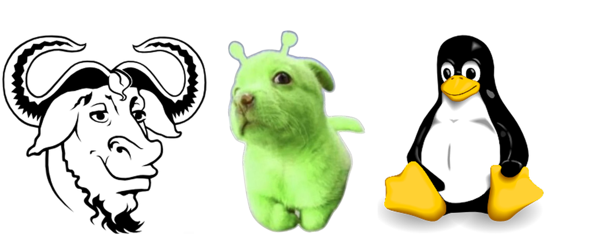

  
  

  <a href="#quem-está-por-aqui">Sobre</a> ·
  <a href="#no-play-meowsic">Meowsic</a> ·
  <a href="#na-bancada">Projetos</a> ·
  <a href="#minha-caixa-de-ferramentas">Tecnologias</a> ·
  <a href="#entre-um-commit-e-outro">Atividade</a>

## Quem está por aqui 🛹

Sou o **André**, estudante de **Sistemas de Informação na UTFPR**. Meus projetos vão de aplicativos para iPhone e jogos a automações e sistemas embarcados.

Gosto de aprender construindo: combinar gatos para criar música, transformar uma foto em informação acessível ou fazer dispositivos conversarem entre si. Por aqui, **Swift** divide espaço com **C/C++, Python, Rust e Linux**.

## Na bancada

Projetos com atualizações recentes, entre apps, comunicação entre dispositivos e web.

  <h3 href="https://github.com/andrezinc/AurisRealesed">Auris</h3>
      
Uma foto da embalagem, mais informação para escolher. App que descreve absorventes com inteligência artificial e recursos de acessibilidade para VoiceOver.

      
<code>Swift</code> <code>SwiftUI</code> <code>IA</code> <code>Acessibilidade</code>

      <a href="https://github.com/andrezinc/AurisRealesed">Conhecer o Auris </a>

  <h3>Metatron</h3>
      
Um iPhone como controle, cinco equipes no placar. Protótipo para estudar comunicação entre dispositivos Apple sem servidor intermediário.

      
<code>Swift</code> <code>SwiftUI</code> <code>MultipeerConnectivity</code>

      <a href="https://github.com/andrezinc/Metatron">Explorar o Metatron </a>

   <h3>Macre · site de suporte</h3>
      
Projeto web para a URL de suporte do Macre.

      
<code>HTML</code> <code>Web</code>

      <a href="https://github.com/andrezinc/site_macre">Ver o site de suporte</a>

  
<strong>Mais experiências pelo caminho</strong>

| Projeto | O que explorei |
| --- | --- |
| [CineFiles](https://github.com/andrezinc/CineFiles) | Aplicativo em Swift relacionado a filmes |
| [UIKit Nano 3](https://github.com/andrezinc/UiKit_Nano3) | Construção de interfaces com UIKit |
| [Cardápio RU UTFPR](https://github.com/andrezinc/Cardapio_RU_UTFPR) | Automação em Python para consultar o cardápio pelo Telegram |
| [Quizzes RustC](https://github.com/andrezinc/quizzes_rustc) | Exercícios de Rust inspirados no Rustlings |
| [Climatologia ESP32](https://github.com/andrezinc/climatologia_esp32) | Monitoramento de condições climáticas com um ESP32 |
| [GetCircules](https://github.com/andrezinc/Game_getCircule) | Jogo em C++ com SFML |

## Minha caixa de ferramentas

  
  
  
  
  
  
  
  

## Entre um commit e outro

  

  
<strong>Linguagens e estatísticas</strong>

  

    
    
  

  

De uma ideia na tela a alguma coisa funcionando.

